

# 🍽️ Foodie

### AI-Powered Recipe Discovery & Personalized Meal Recommendations

**Cook with the ingredients you already have.**

🎓 **Information Technology Graduation Project · 2024**  
**King Abdulaziz University · Faculty of Computing and Information Technology**

  
  
  
  
  

[Project Overview](#project-overview) · [Key Features](#key-features) · [How It Works](#how-foodie-works) · [App Interfaces](#app-interfaces) · [System Architecture](#system-architecture) · [Development Team](#development-team)

---

## 📌 Project Overview

**Foodie** is an AI-assisted mobile application that helps users **discover what they can cook from the ingredients already available to them**. Developed as a senior graduation project, it brings recipe search, image-based ingredient recognition, recipe generation, personalized recommendations and a conversational cooking assistant together in one Flutter application.

The project addresses practical cooking challenges: **limited ingredients, little time to plan meals, missing or expensive ingredients, food allergies and individual food preferences**. By making existing ingredients the starting point for recipe discovery, Foodie aims to simplify meal preparation, reduce unnecessary purchases and support more effective use of food at home.

### 💡 The Challenge and Foodie's Solution

| Challenge | How Foodie responds |
|---|---|
| Only a few ingredients are available | Type the available ingredients or capture a photo to obtain recipe suggestions. |
| Finding a suitable recipe takes time | Search by recipe name and explore matching dishes with preparation instructions. |
| A recipe requires an unavailable ingredient | Ask the chatbot for alternative ingredients. |
| Preferences and dietary restrictions vary | Save cuisine preferences, allergies and health-related dietary selections for tailored recommendations. |
| Planning lunch boxes can be repetitive | Generate kids’, healthy or regular lunch-box ideas with the chatbot. |
| Useful recipes are hard to find again | Save recipes to a personal favorites collection after signing in. |

### 🎯 Project Objectives

Foodie focuses on five goals: **simpler meal planning, less food waste, greater convenience, personalized recommendations and more opportunities to explore new dishes**.

---

## ✨ Key Features

| Feature | What the application provides |
|---|---|
| **Browse without registering** | Use **Not Now** to reach Home, search for recipes and generate recipes from entered or photographed ingredients. |
| **Account registration and verification** | Sign up with account details, verify by phone OTP, sign in and reset a forgotten password. |
| **Recipe search** | Look up dishes by recipe name, browse results and open ingredient lists and cooking instructions. |
| **Ingredient-based generation** | Enter ingredients manually or use the camera and AI-assisted recognition to receive recipe suggestions. |
| **Personalized recommendations** | Choose a preferred cuisine, allergies and health-related selections; save them to shape the **Recommended For You** recipes on Home. |
| **Chat with Foodie** | Ask for ingredient substitutes or choose from kids’, healthy and regular lunch-box suggestions. |
| **Favorites** | Signed-in users can save, revisit and remove recipes from a personalized list. |
| **Profile management** | View and update profile details, edit personalized choices, delete an account or log out. |
| **Complaints and feedback** | Submit a complaint with a title and description and track its recorded status. |
| **Administrator tools** | Authorized administrators can view registered user details and submitted complaints and manage their own admin account. |

**Guest access vs. signed-in access:** Visitors can search for and generate recipes after choosing **Not Now**. Saving favorites, using the chatbot and submitting complaints require the relevant user authentication flow. Personalized choices are saved to the signed-in user's profile.

---

## 🧭 How Foodie Works

### 🚪 1. Opening the App and Choosing an Access Method

Foodie begins at the **Welcome** screen. After **Get Started**, a user can register, sign in or choose **Not Now** to continue without an account. The same sign-in process directs authenticated users or administrators to the appropriate interface.

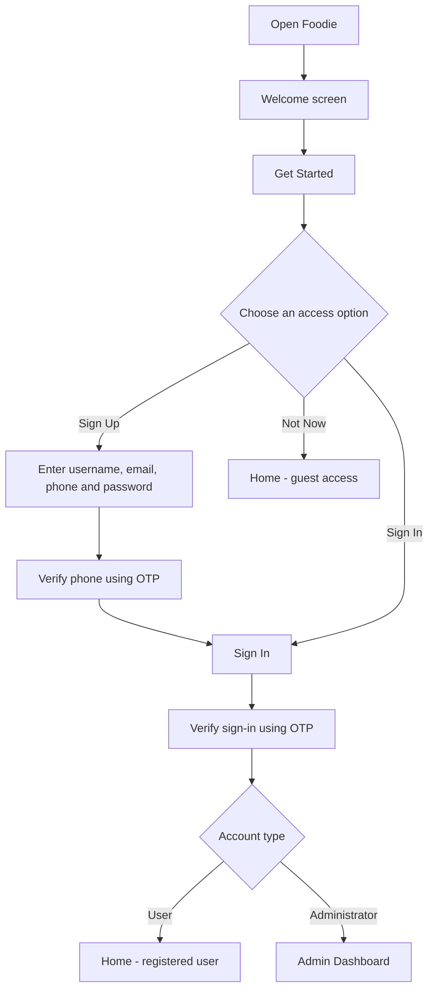

**Access paths:** **Sign Up → Verify → Sign In**, **Sign In → Home**, or **Not Now → Guest Home**. Admin accounts open a separate dashboard.

**Guest users** can explore recipes and use ingredient-based recipe generation. Features that depend on a personal account prompt them to sign in.

### 🍲 2. Searching for and Generating Recipes

From **Home**, users can search by recipe name or provide their available ingredients. Each path leads to recipe suggestions, followed by a recipe-detail screen with ingredients and instructions.

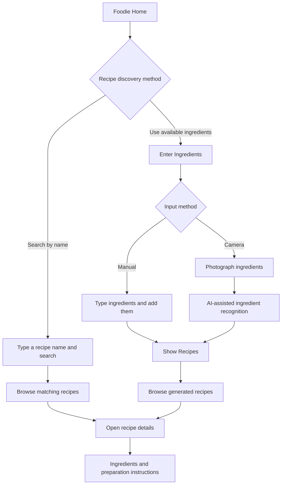

### 🧠 3. Personalized Recommendations, Chat and Account Features

The **Recommended For You** section is driven by saved personalized choices. Users select a **cuisine**, relevant **allergies** and **health-related dietary information** from their profile and save their choices. Foodie then displays recommendations on the **Home** page that reflect those selections. Users can choose **Show More Recipes** or open a suggested dish to read its details.

**For example:** Someone who prefers *Italian* cuisine and selects a *garlic allergy* receives Italian recipe suggestions that avoid garlic.

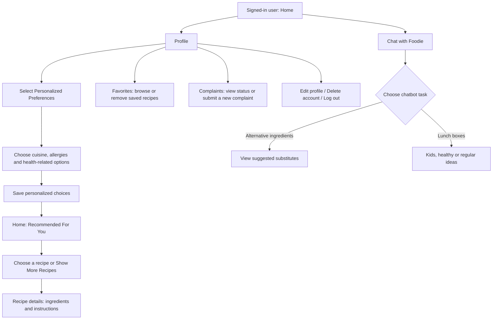

The **Chat with Foodie** feature lets signed-in users request **ingredient substitutes** or choose **kids’, healthy or regular lunch-box ideas**. Profile options also include favorites, complaints and account settings.

An **administrator** signs in through the authentication flow but is routed to a separate dashboard containing **All Users**, **All Complaints** and **About** (admin profile).

---

## 📱 App Interfaces

The following images document the project's application interfaces. Each image is grouped with the related user action, so the end-to-end experience can be followed step by step.

### 🔐 01 · Welcome and Authentication

**User journey:** Welcome → Get Started → Sign Up and phone verification, or Sign In. Users who do not want to create an account can select **Not Now** to proceed to Home.

<table>
  <tr>
    <td width="33%" align="center" valign="top"><strong>Welcome</strong></td>
    <td width="33%" align="center" valign="top"><strong>Sign Up</strong></td>
    <td width="33%" align="center" valign="top"><strong>Phone Verification</strong></td>
  </tr>
  <tr>
    <td align="center" valign="top">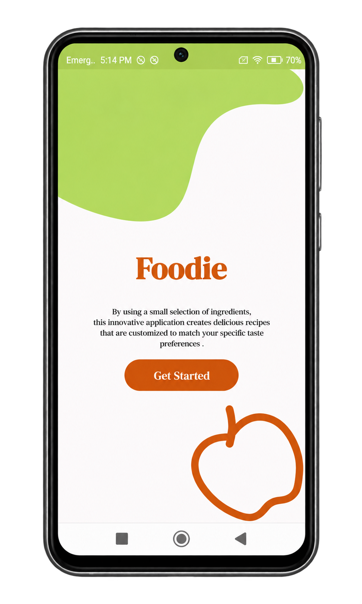</td>
    <td align="center" valign="top">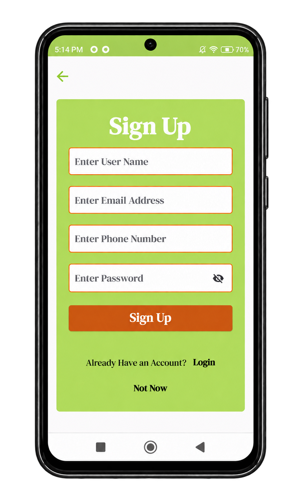</td>
    <td align="center" valign="top"></td>
  </tr>
  <tr>
    <td align="center" valign="top">Introduces Foodie and its purpose. Tap <strong>Get Started</strong> to continue to account access.</td>
    <td align="center" valign="top">Enter a username, email address, phone number and password to create an account.</td>
    <td align="center" valign="top">Enter the six-digit OTP sent to the phone number to complete the verification step.</td>
  </tr>
</table>
<table>
  <tr>
    <td width="33%" align="center" valign="top"><strong>Sign In</strong></td>
  </tr>
  <tr>
    <td align="center" valign="top">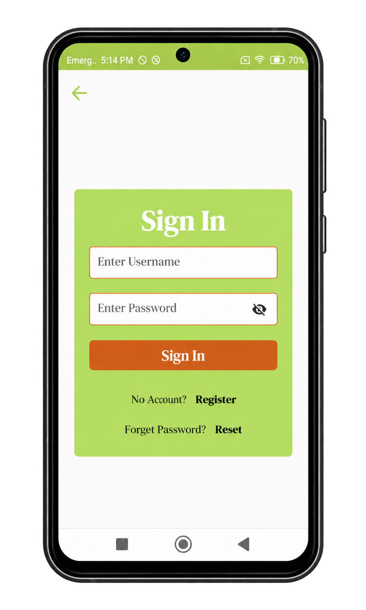</td>
  </tr>
  <tr>
    <td align="center" valign="top">Existing users and administrators enter their credentials and complete verification to access their respective interfaces.</td>
  </tr>
</table>

### 🔎 02 · Home and Recipe Search

**User journey:** Home → type a recipe name → browse matching recipes → open a recipe to see ingredients and cooking instructions. The Home screen also presents **Recommended For You**.

<table>
  <tr>
    <td width="33%" align="center" valign="top"><strong>Home</strong></td>
    <td width="33%" align="center" valign="top"><strong>Search Results</strong></td>
    <td width="33%" align="center" valign="top"><strong>Recipe Details</strong></td>
  </tr>
  <tr>
    <td align="center" valign="top">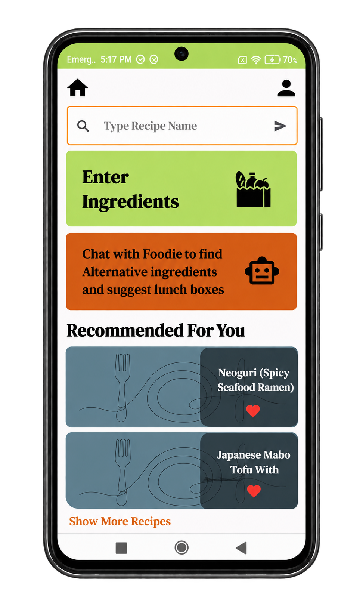</td>
    <td align="center" valign="top">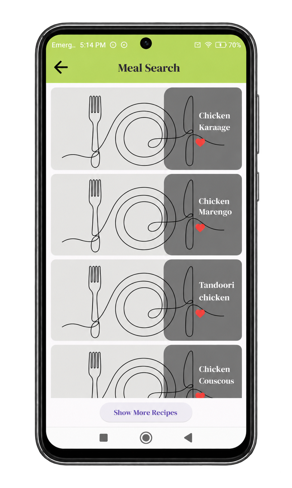</td>
    <td align="center" valign="top">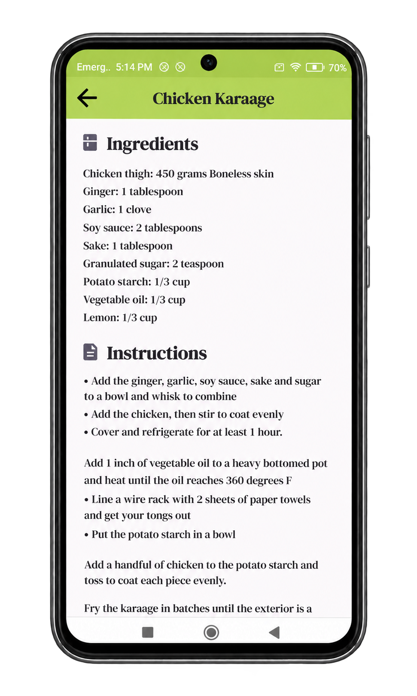</td>
  </tr>
  <tr>
    <td align="center" valign="top">The central navigation page: search by meal name, enter ingredients, open the chatbot, explore recommendations or visit the profile.</td>
    <td align="center" valign="top">Enter a recipe name and search to browse matching meals, then select a result.</td>
    <td align="center" valign="top">Read the selected meal’s ingredients and preparation instructions. Signed-in users can save a recipe to favorites.</td>
  </tr>
</table>

### 🥦 03 · Recipes From Available Ingredients

**User journey:** Home → Enter Ingredients → type ingredient names **or** take a photo → Show Recipes → browse recipe suggestions → select a recipe. Ingredient entry and recipe generation are also available to guests.

<table>
  <tr>
    <td width="33%" align="center" valign="top"><strong>Enter Ingredients</strong></td>
    <td width="33%" align="center" valign="top"><strong>Ingredient Camera</strong></td>
    <td width="33%" align="center" valign="top"><strong>Generated Recipes</strong></td>
  </tr>
  <tr>
    <td align="center" valign="top">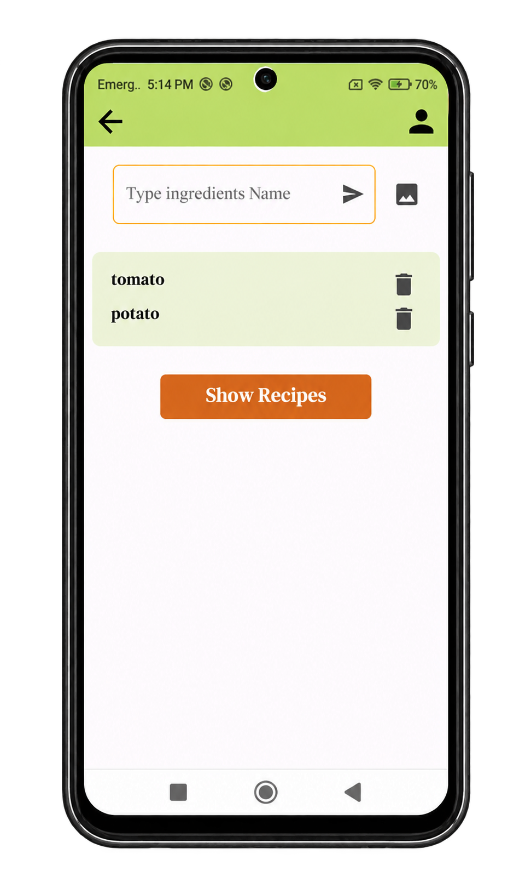</td>
    <td align="center" valign="top">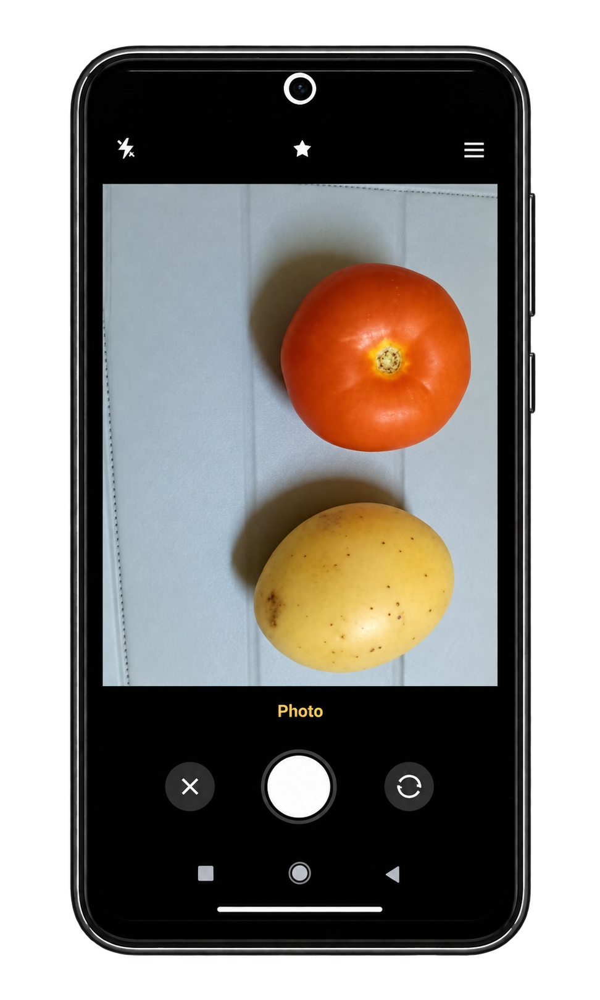</td>
    <td align="center" valign="top">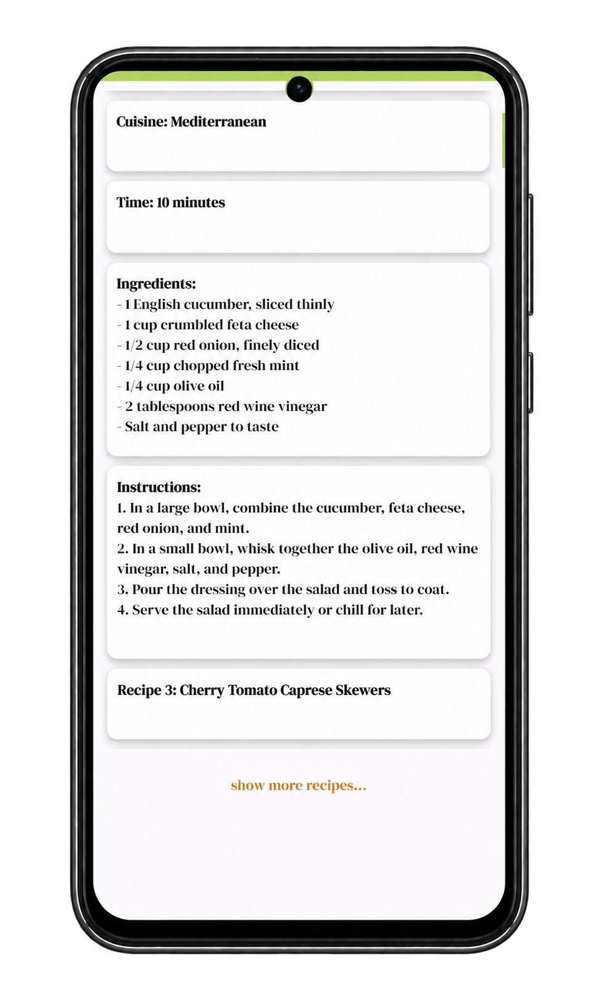</td>
  </tr>
  <tr>
    <td align="center" valign="top">Type the available ingredients, add or remove items, and select <strong>Show Recipes</strong>.</td>
    <td align="center" valign="top">Photograph ingredients so the image can be used for AI-assisted recognition and recipe suggestions.</td>
    <td align="center" valign="top">Browse recipes suggested from the entered or recognized ingredients and open a recipe for more information.</td>
  </tr>
</table>

### 🎯 04 · Personalized Recommendations

**User journey:** Sign In → Profile → Select Personalized Preferences → choose preferred cuisine, allergies and health-related selections → Save → return to Home and explore **Recommended For You**. Tap a suggested recipe to open its details; use **Show More Recipes** for additional choices.

<table>
  <tr>
    <td width="33%" align="center" valign="top"><strong>Personalized Choices</strong></td>
  </tr>
  <tr>
    <td align="center" valign="top">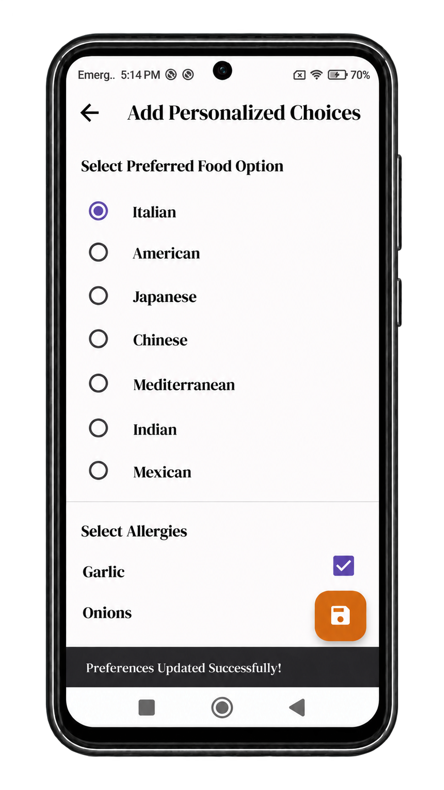</td>
  </tr>
  <tr>
    <td align="center" valign="top">From the profile, select a preferred cuisine, allergies and health-related dietary information, then save the choices.</td>
  </tr>
</table>

### 💬 05 · Chat with Foodie

**User journey:** Sign In → Home → Chat with Foodie → choose whether to request an alternative ingredient or a suggested lunch box. Lunch-box suggestions can be organized for kids, healthy meals or regular meals.

<table>
  <tr>
    <td width="33%" align="center" valign="top"><strong>Ingredient Alternatives</strong></td>
    <td width="33%" align="center" valign="top"><strong>Lunch-Box Suggestions</strong></td>
  </tr>
  <tr>
    <td align="center" valign="top">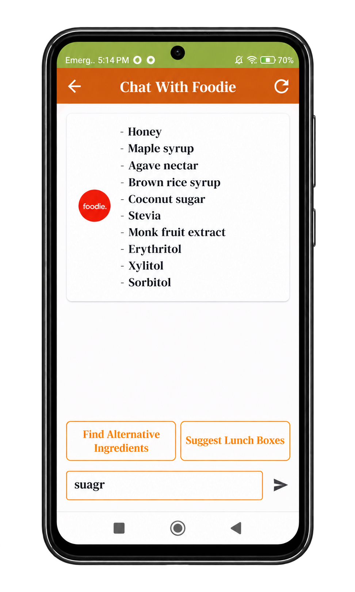</td>
    <td align="center" valign="top">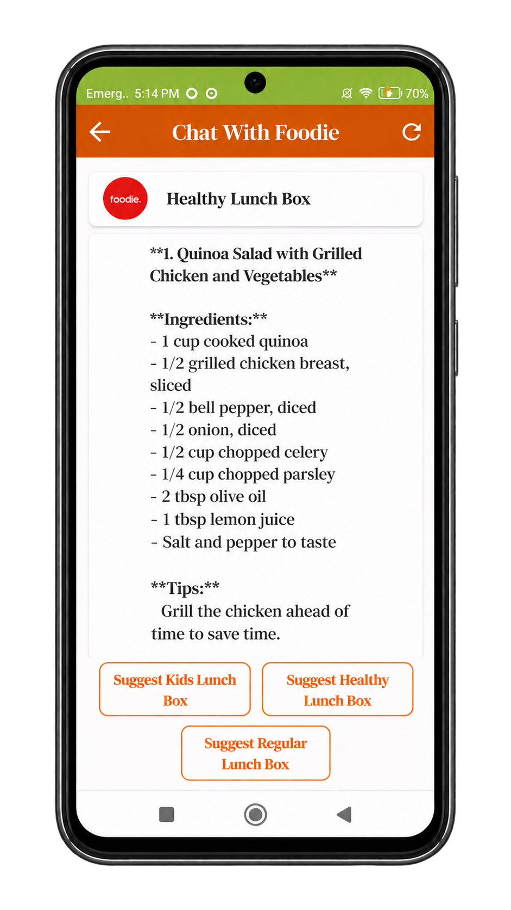</td>
  </tr>
  <tr>
    <td align="center" valign="top">Ask <strong>Chat with Foodie</strong> to suggest substitutes when an ingredient is unavailable or unsuitable.</td>
    <td align="center" valign="top">Ask the chatbot for <strong>kids’</strong>, <strong>healthy</strong> or <strong>regular</strong> lunch-box ideas.</td>
  </tr>
</table>

### 👤 06 · User Profile, Favorites and Complaints

**User journey:** Sign In → Profile → manage account information and saved recipes, or view and submit complaints. The profile also includes preferences and account actions such as deletion and logout.

<table>
  <tr>
    <td width="33%" align="center" valign="top"><strong>User Profile</strong></td>
    <td width="33%" align="center" valign="top"><strong>Favorites</strong></td>
    <td width="33%" align="center" valign="top"><strong>My Complaints</strong></td>
  </tr>
  <tr>
    <td align="center" valign="top">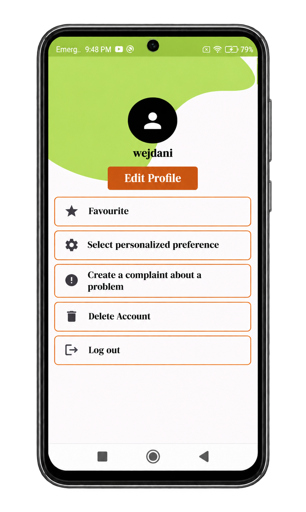</td>
    <td align="center" valign="top">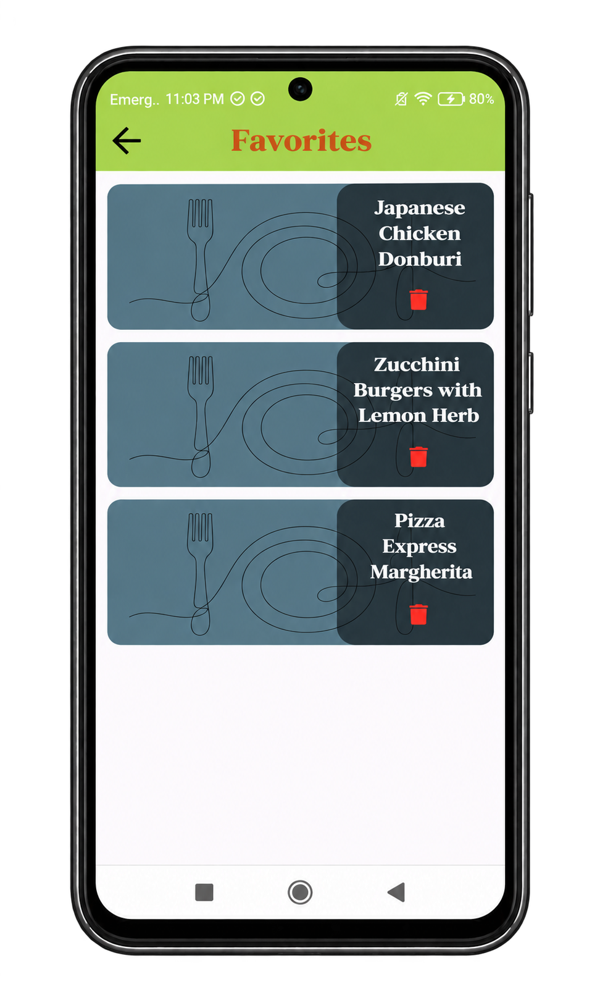</td>
    <td align="center" valign="top">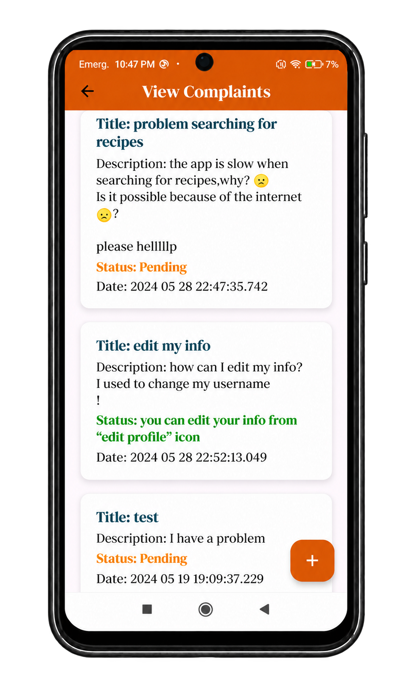</td>
  </tr>
  <tr>
    <td align="center" valign="top">Access edit profile, saved recipes, personalized choices and complaints, or manage account options.</td>
    <td align="center" valign="top">Revisit saved recipes, open their details and remove items from the saved list.</td>
    <td align="center" valign="top">View submitted complaints with their titles, descriptions, dates and statuses; open the form to submit another.</td>
  </tr>
</table>
<table>
  <tr>
    <td width="33%" align="center" valign="top"><strong>Add a Complaint</strong></td>
  </tr>
  <tr>
    <td align="center" valign="top">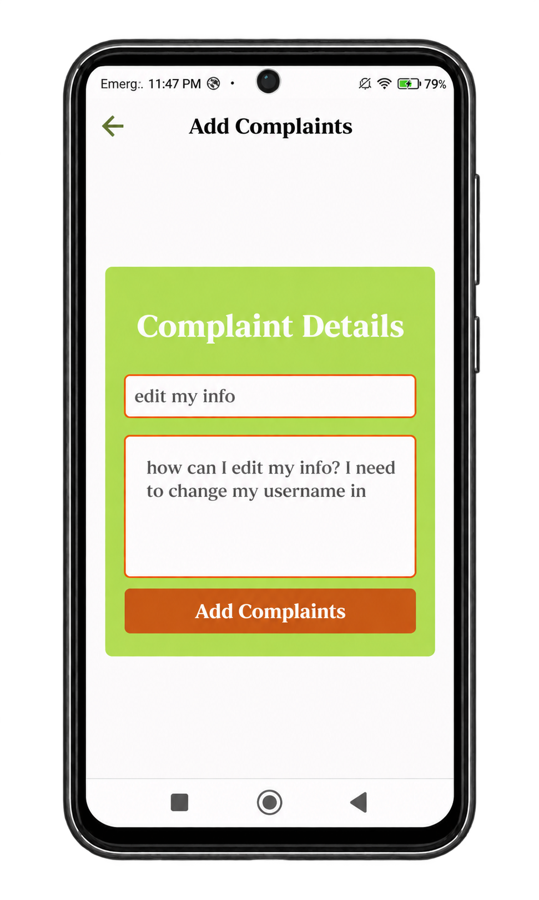</td>
  </tr>
  <tr>
    <td align="center" valign="top">Enter a complaint title and description and submit it to be stored with a status and date.</td>
  </tr>
</table>

### 🛠️ 07 · Administration

The **Administrator** area is a separate interface for authorized application administrators, rather than regular app users. After signing in, an administrator can **view registered users and their account information**, **inspect submitted complaints and their statuses**, and **manage the administrator's own profile**. This interface is intended for application management and oversight.

<table>
  <tr>
    <td width="33%" align="center" valign="top"><strong>Admin Dashboard</strong></td>
    <td width="33%" align="center" valign="top"><strong>All Users</strong></td>
    <td width="33%" align="center" valign="top"><strong>All Complaints</strong></td>
  </tr>
  <tr>
    <td align="center" valign="top">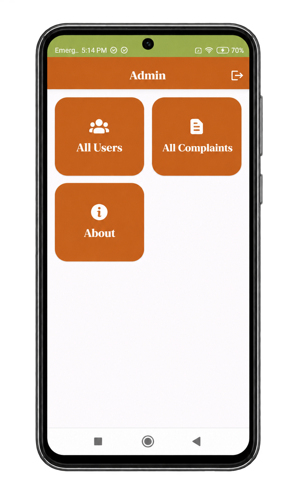</td>
    <td align="center" valign="top">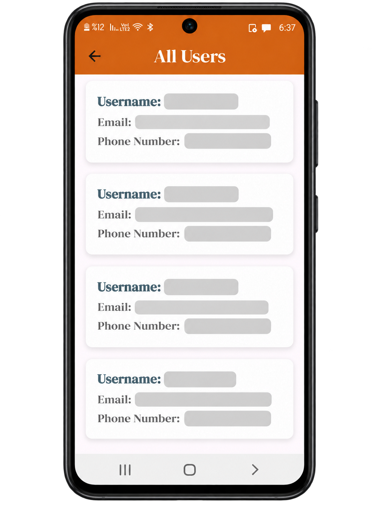</td>
    <td align="center" valign="top">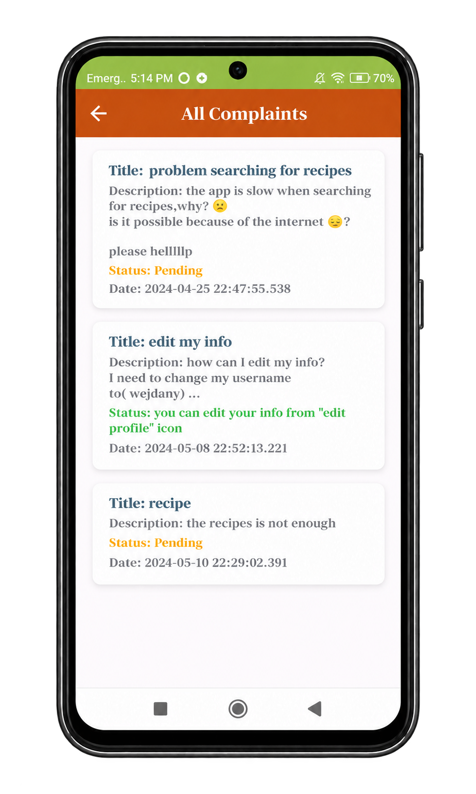</td>
  </tr>
  <tr>
    <td align="center" valign="top">A dedicated administration home screen with <strong>All Users</strong>, <strong>All Complaints</strong>, <strong>About</strong> and log out.</td>
    <td align="center" valign="top">View registered user accounts and their listed usernames, emails and phone numbers.</td>
    <td align="center" valign="top">Inspect submitted user complaints, including their descriptions, statuses and dates.</td>
  </tr>
</table>
<table>
  <tr>
    <td width="33%" align="center" valign="top"><strong>Admin Account</strong></td>
    <td width="33%" align="center" valign="top"><strong>Edit Admin Profile</strong></td>
  </tr>
  <tr>
    <td align="center" valign="top">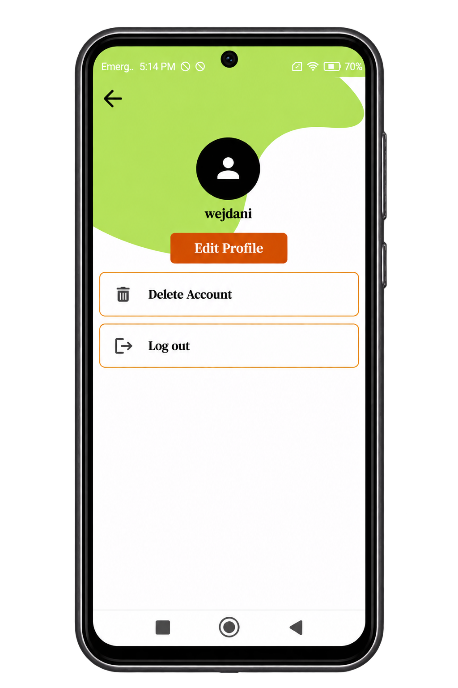</td>
    <td align="center" valign="top">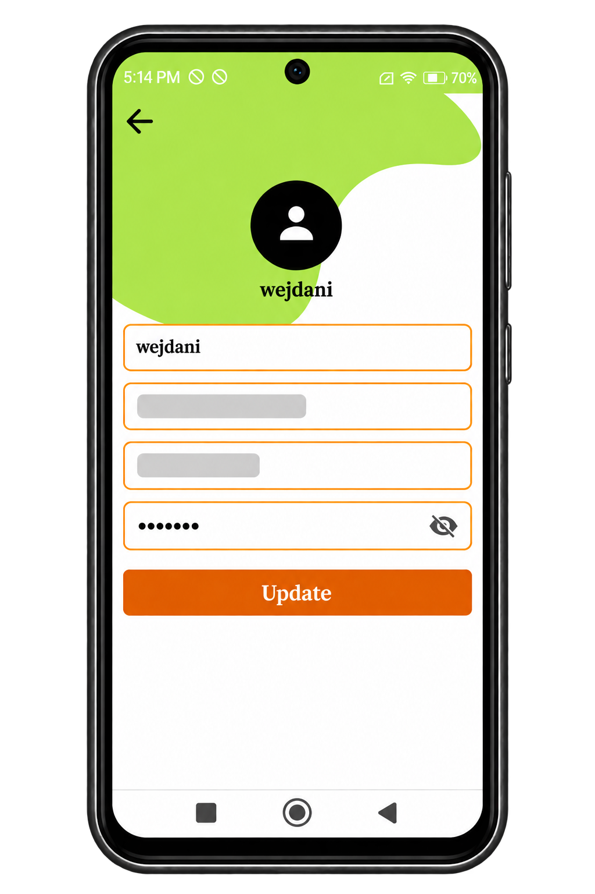</td>
  </tr>
  <tr>
    <td align="center" valign="top">Open the administrator’s account page to edit profile details, delete the account or log out.</td>
    <td align="center" valign="top">Review and update the administrator account fields through the profile-editing screen.</td>
  </tr>
</table>

---

## 🧰 Technology Stack

| Technology | Role in Foodie |
|---|---|
| **Flutter & Dart** | Mobile user interface, navigation, forms and application logic. |
| **Firebase Authentication** | Account creation, sign-in and phone-number verification flows. |
| **Cloud Firestore** | Data storage for user accounts, personalized choices, favorites and complaints. |
| **Google Generative AI (Gemini 1.5 Pro)** | AI-assisted content generation, ingredient/image interpretation, recipe suggestions and chatbot responses. |
| **TheMealDB API** | Recipe-name search and meal information. |
| **Spoonacular API** | Recipe data used in personalized recommendation features. |
| **Image Picker / Device Camera** | Photograph or select ingredient images. |
| **SharedPreferences** | Local storage of selected preference values. |
| **Android Studio** | Android development and testing environment. |

---

## 🏗️ System Architecture

Foodie's architecture links its Flutter application to authentication and cloud data storage, alongside recipe information services and AI-assisted features. The diagram shows how the app connects user-facing features with authentication, cloud storage, recipe data, AI services and the device camera.

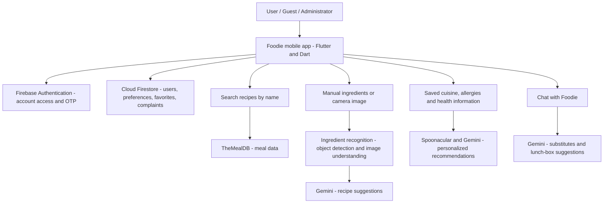

**Data flow:** User account information and saved preferences live in Firestore; authenticated user features can retrieve stored recipes and complaints. Search and recommendation modules obtain recipe content through the integrated services, while AI supports ingredient-based generation and conversational suggestions.

---

## ⚙️ Getting Started

To run Foodie locally, follow the instructions in [SETUP.md](SETUP.md) to install the required dependencies and configure Firebase, Gemini and Spoonacular.

---

## 👥 Development Team

**Information Technology Graduation Project · King Abdulaziz University · 2024**

- **Wejdan Alnafai**
- **Mawaddah AlSfri**
- **Nada AlHarbi**
- **Darin AlBukhari**
- **Shahad AlAmri**
